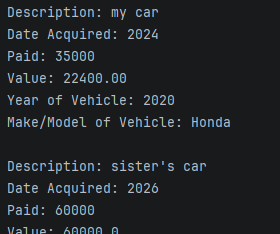

## Assets Manager

#### Try to create an instance of an Asset. What happens?
When I try to create an instance of an asset it give me an error because the class is abstract.
#### What issues are you running into when you try to create the Cash class? What are you options to address these issues?
I get an error of it can not extend because the class is abstract. To address this
issue is to import and override the getValue method from the parent class to the child class.
If I were not to put the gtValue() method I could remove abstract from getValue so it can be accessed by the class.

Removed the field cash and decided to put the variable in the constructor
